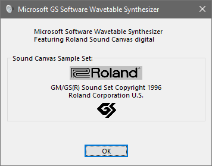
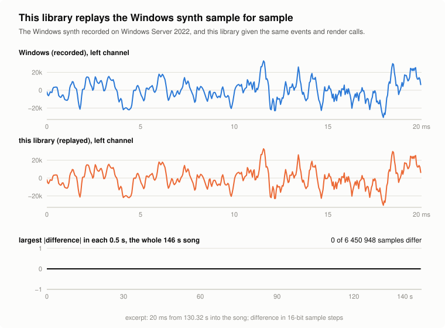
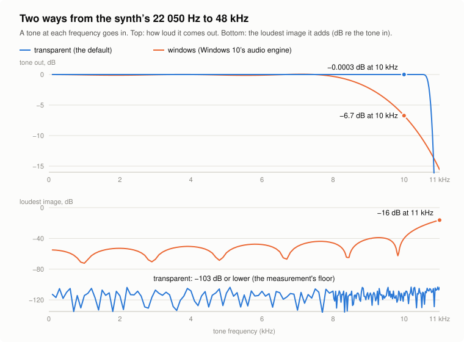

<div align="center">

# open-gs-wavetable-synth

**The Microsoft GS Wavetable Synth, bit-exact, on every platform.**<br>
Render MIDI with Windows' `gm.dls` on macOS, iOS, Linux, Windows and WebAssembly through the
Windows synth's own engine, reproduced sample for sample.

[](https://github.com/nunchuk/open-gs-wavetable-synth/actions/workflows/ci.yml)
[](LICENSE)
[](#use-it-from-cmake)
[](#at-a-glance)

[Quick start](#quick-start) · [Sample for sample](#sample-for-sample-the-windows-synth) · [22 050 Hz or 48 kHz](#22-050-hz-or-48-khz) · [FAQ](#faq)


<br>
<sub>The synth this library reimplements, as Windows shows it: Microsoft's software synthesizer
playing Roland's 1996 GM/GS sound set (<code>gm.dls</code>).</sub>

</div>

A bit-exact, portable C++20 reimplementation of the **Microsoft GS Wavetable Synth** (MSGS), the
MIDI synthesizer built into Windows. Render MIDI files with Windows' `gm.dls` on **macOS, iOS,
Linux, Windows and the Web (WebAssembly)** and get the Windows synth's sound: given the same MIDI
events at the same sample times and the same render calls, the output equals the Windows synth's,
sample for sample. No dependencies beyond the C++ standard library; MIT licensed.

## At a glance

| | |
|---|---|
| What | The DirectMusic synth core of Windows' `SysWOW64\wdmaud.drv` 10.0.20348.2849 (`CSynth`, `CControlLogic`, `CVoice`, `CVoiceEG`, `CVoiceLFO`, `CDigitalAudio`, `CInstManager`, the DLS loader), reconstructed from its disassembly with Microsoft's public symbols |
| Accuracy | Bit-exact: 52 recordings of the Windows synth (64.0 M frames) replayed through this library, 0 differing samples |
| Input | A DLS level 1 bank (Windows' `gm.dls`) and a Standard MIDI File, or MIDI messages stamped with sample times |
| Output | 22 050 Hz 16-bit stereo, the synth's only rate; 48 kHz float through a transparent or Windows 10's converter |
| Also | A MIDI file player that sends messages as Windows' MCI sequencer (`mciseq.dll`) does: order, chase on seek, pause and resume |
| Platforms | Any C++20 compiler. CI: Linux (GCC, Clang), macOS (AppleClang), Windows (MSVC), WebAssembly (Emscripten on Node.js). The same code runs in the iOS app it comes from |
| Speed | 184 s of music in 0.13 s (about 1 400 times real time; with the transparent 48 kHz conversion, 250 times), Apple M4 |
| Dependencies | None; CMake 3.21 or later to build |
| Use it from | CMake (`FetchContent`, `add_subdirectory`, `find_package`), the `gswavetable-render` CLI, release binaries |
| License | MIT. `gm.dls` is part of Windows and not included |

## Quick start

### Command line

```sh
cmake -S . -B build -DCMAKE_BUILD_TYPE=Release && cmake --build build
build/gswavetable-render gm.dls song.mid song.wav              # 16-bit PCM, 22 050 Hz
build/gswavetable-render --48k gm.dls song.mid song-48k.wav    # 32-bit float, 48 000 Hz, transparent
build/gswavetable-render --48k windows gm.dls song.mid w.wav   # 48 000 Hz as Windows 10 converts it
build/gswavetable-render --from 1920 gm.dls song.mid tail.wav  # from tick 1920, with the chase
```

The WAV ends where the file ends (its last tick), where Windows closes the MIDI port. Releases
(from v0.1.0) attach `gswavetable-render` built for Linux, macOS (universal), Windows and Node.js
(`node gswavetable-render.js ...`), with the library and its CMake package.

### Use it from CMake

```cmake
include(FetchContent)
FetchContent_Declare(gswavetable
  GIT_REPOSITORY https://github.com/nunchuk/open-gs-wavetable-synth.git
  GIT_TAG main) # pin a release tag or a commit for reproducible builds
FetchContent_MakeAvailable(gswavetable)
target_link_libraries(your_app PRIVATE gswavetable::gswavetable)
```

As a subproject it builds only the library (`add_subdirectory` works the same way). Installed
(`cmake --install build`), it is found with `find_package(gswavetable 0.1 REQUIRED)`.

### Render a MIDI file in C++

[`examples/render_wav.cpp`](examples/render_wav.cpp), which CI builds and checks against a golden render:

```cpp
// Renders a MIDI file to a 22 050 Hz WAV the way Windows' Microsoft GS Wavetable Synth plays it.
//   render_wav gm.dls song.mid song.wav
#include <gswavetable/player.hpp>

#include <cstdint>
#include <fstream>
#include <iterator>
#include <vector>

static std::vector<std::uint8_t> read(const char *path) {
    std::ifstream in(path, std::ios::binary);
    return {std::istreambuf_iterator<char>(in), {}};
}

int main(int argc, char **argv) {
    if (argc != 4)
        return 2;
    // Throws std::runtime_error for a bank the synth rejects, std::invalid_argument for a bad MIDI file.
    gswavetable::Player player(gswavetable::load_dls(read(argv[1])));
    player.play(gswavetable::Sequencer(read(argv[2]))); // from tick 0; play(song, tick) starts later
    std::vector<std::int16_t> pcm, block(2 * 1024);      // 22 050 Hz, 16-bit, stereo interleaved
    while (player.playing()) {                           // until the file's end
        const auto frames = player.render(block.data(), 1024);
        pcm.insert(pcm.end(), block.begin(), block.begin() + 2 * std::ptrdiff_t(frames));
    }
    // A 44-byte WAV header (PCM, stereo, 22 050 Hz, 16-bit), then the samples (little-endian hosts).
    const auto bytes = std::uint32_t(pcm.size() * 2);
    const std::uint32_t header[] = {0x46464952, 36 + bytes, 0x45564157, 0x20746d66, 16,    0x00020001,
                                    22050,      22050 * 4,  0x00100004, 0x61746164, bytes};
    std::ofstream out(argv[3], std::ios::binary);
    out.write(reinterpret_cast<const char *>(header), sizeof header);
    out.write(reinterpret_cast<const char *>(pcm.data()), std::streamsize(bytes));
    return out ? 0 : 1;
}
```

- `Player` (`player.hpp`) plays like MCI: `play(song, tick)`, `pause()`, `resume()`, `stop()`,
  `position()` in ticks. `render` fills the buffer it is given and returns how many frames are
  music (the rest is silence once the file has ended), so it can feed an audio callback:
  [`examples/audio_callback.cpp`](examples/audio_callback.cpp) streams 48 kHz float frames on demand.
- `TransparentResampler` and `WindowsResampler` (`resampler.hpp`) convert to 48 kHz (below).
- `Synth` (`engine.hpp`) is the synth alone, for your own events: `play(sample_time, message)`
  and `render(buffer, frames, position)`.

## Sample for sample the Windows synth

<picture>
  <source media="(prefers-color-scheme: dark)" srcset="docs/images/bitexact-dark.svg">
  
</picture>

On Windows Server 2022 a 32-bit program played MIDI files through MCI while
`CUserModeSynth::PlayBuffer` (every event with its sample time) and `CUserModeSynth::Render` (every
buffer the synth produced) were hooked and recorded. Replaying the recorded events and render calls
through this library reproduces every sample:

| Recordings | Frames | Differing samples |
|---|---|---|
| 35 plays of 25 MIDI files, from the start or restored mid-file | 58 448 809 | 0 |
| 17 seeks, chases and pauses | 5 587 466 | 0 |

The engine's tables (1 884 entries) equal the ones the driver computes, read from its `.data`
section. In this repository the golden renders (`tests/data/golden.tsv`) pin that output, and CI
checks that every platform renders them to the same SHA-256.

## 22 050 Hz or 48 kHz

<picture>
  <source media="(prefers-color-scheme: dark)" srcset="docs/images/converters-dark.svg">
  
</picture>

The synth runs at 22 050 Hz, and that stream is its sound. Most devices play 44.1 or 48 kHz, so it
has to be converted, and the conversion changes what you hear:

- `transparent` (`TransparentResampler`, the CLI's `--48k`): a band-limited reconstruction that
  adds and takes away nothing audible (a Kaiser-windowed sinc cut at 10 762.5 Hz, 140 input frames
  each side, linear phase). This is the synth's own sound, as Windows XP played it on a card that
  runs at 22 050 Hz: XP's mixer passed the stream on unconverted.
- `windows` (`WindowsResampler`, `--48k windows`): Windows 10's audio engine's converter, as a
  48 kHz endpoint gets the stream there (identified from loopback recordings, to -144.8 dB, float
  precision). It sounds duller: on four MIDI files matched in loudness, the 10 kHz third octave is
  4.9-5.7 dB under the transparent conversion, the same within 0.1 dB below 6 kHz, and images
  above 11 kHz hold -43..-49 dB of the energy.

Pick `windows` to sound as Windows 10 does at a 48 kHz endpoint, `transparent` for the synth itself.
The chart's data ([`docs/charts/converter_response.csv`](docs/charts/converter_response.csv)), at a
few frequencies:

| Tone | transparent: tone out | transparent: loudest image | windows: tone out | windows: loudest image |
|---|---|---|---|---|
| 1 kHz | -0.0003 dB | -114 dB | -0.06 dB | -72 dB |
| 8 kHz | -0.0003 dB | -109 dB | -0.31 dB | -46 dB |
| 10 kHz | -0.0003 dB | -111 dB | -6.73 dB | -40 dB |
| 10.5 kHz | -0.0001 dB | -130 dB | -10.43 dB | -24 dB |
| 11 kHz | -75.8 dB | -104 dB | -15.58 dB | -16 dB |

## Where to get gm.dls

`gm.dls` (the Roland GS sound set licensed to Microsoft) is part of Windows and is not included
here. Copy it from a Windows installation: `C:\Windows\System32\drivers\gm.dls`. The copy this
engine was verified with is Windows Server 2022's: 3 440 660 bytes, SHA-256
`3229b09b9d7d9f3f4793b0d9b34fe6abc75cfa4a2503c0c90f43ff651ba7f2c0`; Windows XP's is byte-identical.
The tests run without it, on a small generated bank (`tests/data/sine.dls`); with
`GSWAVETABLE_DLS=/path/to/gm.dls` they also check the `gm.dls` goldens.

## What it does, and does not, do

- Output: 22 050 Hz, 16-bit stereo, the only rate the Windows synth opens with.
- Voices: 32, plus 8 kept in reserve by quick-stopping the oldest notes, with Windows' voice
  stealing, priorities, exclusive key groups and same-note handling.
- No reverb and no chorus (Windows opens the synth without them). The DLS2 filter is not
  implemented: DLS1 banks such as `gm.dls` never enable it. Playing a wave of 512 Ki frames or more
  ("big-sample mode") throws `std::runtime_error` from `render`.
- MIDI: note on/off, program change, pitch bend; CC1 (modulation, as deep as the bank's
  articulation makes it), 7, 10, 11, 64, 120, 121, 123, 126/127 (mono/poly); RPN 0 (bend range),
  1 (fine tune) and 2 (coarse tune) through CC101/100 and data entry CC6/38; bank select CC0/32,
  ignored until a GS reset as on Windows. CC74, CC91, CC93 and channel pressure are recorded with
  no audible effect (no filter, no effects, no pressure depth in DLS1); an NRPN (CC98/99) only
  cancels the RPN. SysEx: GS reset, GS part to channel, GS rhythm part, GS scale tuning,
  XG System On, GM System On, master volume.
- Mixing: the x86 MMX path Windows uses on any current CPU (spans of more than 8 frames through
  `CDigitalAudio::Mix16X`, shorter ones through `Mix16`), including its saturation and rounding.
- Timing: the player renders in Windows' 10 ms cycles (221 and 220 frames, the WASAPI period), so
  envelopes, control spans and the voice reserve run as on Windows. The messages and their order
  are `mciseq.dll`'s (tracks merged in tick, track and file order; a note-off before a note-on for
  a note that is on; on a seek, every earlier event except note-ons). Their times are not:
  `mciseq` truncates each event's time to whole milliseconds and sends it from a timer (drifting by
  up to 1.4 s over a long file), while this player puts each event on the exact tempo-map time,
  rounded to the nearest frame (within 0.511 frames, nothing accumulates). A play starts at the
  next render cycle, without Windows' 0.25-0.3 s start-up latency.
- Threads: each `Synth` or `Player` may be used by one thread at a time. A loaded bank is
  immutable and may be shared by synths on different threads.

## When not to use it

- You need reverb or chorus: the Windows synth has none here. Add your own effects after it.
- You need SoundFont (SF2) banks or DLS2 features: it reads DLS level 1 only.
- You want a Roland Sound Canvas (SC-55, SC-88): this is Microsoft's synth playing Roland's sample
  set, not an emulation of Roland's hardware.
- You need Windows' MCI timing to the millisecond, drift included: the player uses the exact tempo
  map. Drive `Synth` yourself to send events at any times.
- You need another output rate: 22 050 and 48 000 Hz are built in. For 44 100 Hz, upsample the
  22 050 Hz stream by two with a resampler of your choice.

## FAQ

**How do I make MIDI files sound like Windows on macOS or Linux?** Get `gm.dls` from a Windows
installation and run `gswavetable-render gm.dls song.mid song.wav`, or use `Player` in your program.

**Is the output identical to Windows?** The synth is: given the same events at the same sample times
and render calls, every sample is equal (above). A file played by this player differs from a
recording of Windows playing it through MCI only in event timing (the exact tempo map against
`mciseq`'s millisecond timer); at 48 kHz it depends on the converter you pick.

**Can I use another DLS bank?** DLS level 1 banks with 8- or 16-bit mono waves load and play;
only `gm.dls` was compared with Windows.

**Does it run in the browser?** It builds with Emscripten, and CI runs its tests on Node.js; the
releases include a Node.js build of the CLI. The CMake target builds with WebAssembly exception
handling (`-fwasm-exceptions`), which every current browser and Node.js support. There is no web
demo or npm package yet.

**Can I call it from Python, Rust or JavaScript?** Not directly yet: the API is C++ (there is no C
API). Wrapping `Player` is a few functions.

**Is it fast enough for real time and for phones?** Yes: about 1 400 times real time on an Apple
M4; in the game port it comes from, a steady mixing pass (synth, converter and mixer) takes about
2 ms of each 21 ms buffer on a 2015 iPad mini 4.

## Known limitations

- Only the x86 driver's MMX path was checked against Windows. The x64 driver
  (`System32\wdmaud.drv`, used by 64-bit programs) and Windows 11 were not compared.
- Only `gm.dls` (the SHA-256 above) was checked; other DLS banks load, but were not compared with
  Windows.
- The player's event timing is the exact tempo map, not `mciseq`'s millisecond timer (see Timing),
  so a recording of Windows playing a file through MCI differs from this player's output in event
  timing, while the synth itself is identical.

## License and trademarks

MIT, see [LICENSE](LICENSE). `gm.dls` is not covered and not distributed.

Microsoft, Windows and DirectMusic are trademarks of Microsoft Corporation. Roland, GS and Sound
Canvas are trademarks of Roland Corporation. This project is not affiliated with or endorsed by
either; the about box above is shown to identify the software it reimplements.
